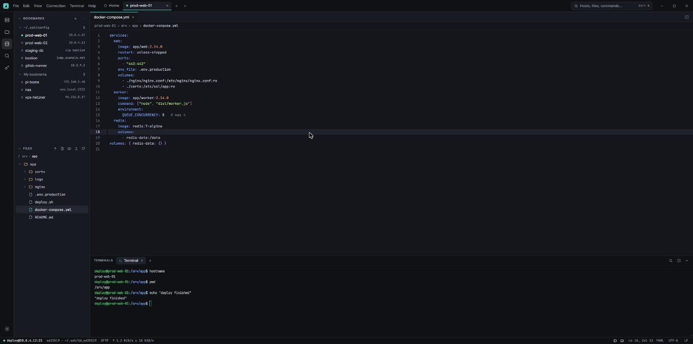
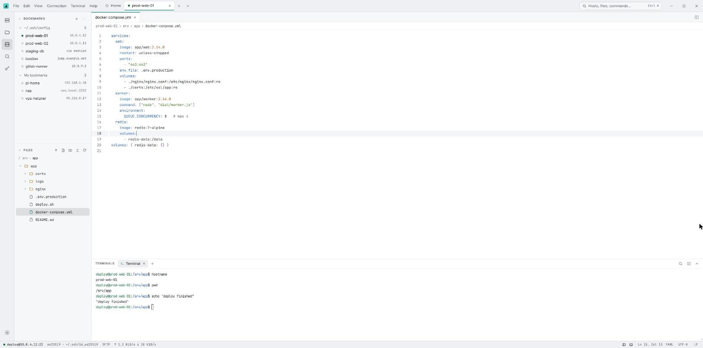

<p align="center">
  
</p>

# Shellfin

[](https://github.com/shellfin-app/shellfin/actions/workflows/ci.yml)

An open-source, cross-platform desktop SSH client: connections in tabs, terminals, a remote file tree and a
built-in editor in one window. Built with Tauri 2, Rust ([russh](https://github.com/Eugeny/russh)) and
React/TypeScript. Licensed MIT OR Apache-2.0.

Website: <https://shellfin.app>

> **Status: version 0.1.1 (early release).** Expect rough edges and breaking changes before 1.0. The security
> design has not had an independent audit.

<p align="center">
  
  
</p>

## Features

- **Connections:** multiple simultaneous SSH connections as tabs; direct or through any number of `ProxyJump`
  hops; "Test connection"; auto-reconnect that keeps editor buffers and terminal scrollback; manual
  disconnect/reconnect; optionally reopens the previous connections on startup; OS notifications when a connection
  drops or transfers finish while the window is in the background.
- **Hosts:** reads `~/.ssh/config` (including `Include`, wildcards, `Host *` defaults, negation, a subset of
  `Match`) and `known_hosts`; config hosts appear read-only next to your own bookmarks (groups, tags, colours,
  drag-and-drop ordering, start directory, startup command, "confirm before connecting"). Quick connect with
  `user@host:port`. Import and export bookmarks as JSON or OpenSSH config (passwords are never exported).
- **Authentication:** key files (including encrypted keys, RSA with SHA-2), ssh-agent (Windows OpenSSH agent,
  Pageant through its OpenSSH pipe, `SSH_AUTH_SOCK`), password and keyboard-interactive (including 2FA). Saved
  passwords go to the OS keychain only, bound to the destination.
- **Terminals:** several per connection (xterm.js with WebGL), find, "Save output...", safe paste (control
  characters stripped, multi-line confirmation), clickable links with confirmation, "Open terminal here".
- **Files:** lazy SFTP tree for large folders, new file/folder, rename, move, delete, multi-file upload and
  download (picker or drag and drop), 1 to 64 concurrent transfers per connection (default 3), optional bandwidth
  limits, hints for files you probably cannot write.
- **Editor:** CodeMirror 6 with syntax highlighting, non-UTF-8 encodings, line-ending handling and **atomic,
  conflict-safe saves** that preserve permissions and ownership; saves requested while offline run after
  reconnecting.
- **Appearance:** dark, light or system theme, six accent colours, interface text size 12 to 16, reduced motion and a
  configurable terminal background; many terminal, editor and file-tree settings, applied live.
- **Desktop UX:** frameless window with an in-app menu bar (native menu on macOS), command palette, layout-independent
  keyboard shortcuts, a maximizable terminal panel, UI in English and Ukrainian (switchable in Settings; more
  languages welcome, see CONTRIBUTING).
- **Updates:** signed automatic updates (Windows, macOS, Linux AppImage); checks can be turned off, and nothing is
  installed without your OK. `.deb`/`.rpm` installs get a download link.
  See [Updates](#updates).

Not in v1: port-forwarding UI, split panes, `ProxyCommand`, SSH host certificates, FIDO keys, GSSAPI, X11/agent
forwarding, recursive directory transfer.

## Platform support

| Platform | Architecture |
|---|---|
| Windows 10/11 | x64 and ARM64 (NSIS `.exe` installer) |
| Linux | x64 (AppImage, deb, rpm) |
| macOS 11+ | Apple Silicon (arm64) |

32-bit Windows and Intel Macs are not supported. CI builds all of the above on every change; release builds are
produced by a protected workflow (see [CONTRIBUTING.md](CONTRIBUTING.md#releasing)).

## Install

Download the file for your system from the [latest release](https://github.com/shellfin-app/shellfin/releases/latest)
(`<version>` is the release number).

| System | File |
|---|---|
| Windows 10/11 x64 | `Shellfin_<version>_x64-setup.exe` |
| Windows 11 ARM64 | `Shellfin_<version>_arm64-setup.exe` |
| macOS 11+ (Apple Silicon) | `Shellfin_<version>_aarch64.dmg` |
| Linux x64 | `Shellfin_<version>_amd64.AppImage`, `.deb` or `.rpm` |

### Windows

Run the NSIS installer. It installs **per user** (no administrator rights needed) and offers to start Shellfin
afterwards. Uninstall it from Settings > Apps. On Windows 10 without the WebView2 runtime the installer downloads it,
so it needs an internet connection that time (Windows 11 has WebView2 already).

*Unsigned builds:* while a release is not code-signed, Microsoft Defender SmartScreen shows "Windows protected your
PC". Choose **More info**, then **Run anyway**. Verify the download first (see below).

### macOS

With [Homebrew](https://brew.sh) (Apple Silicon):

```sh
brew install --cask shellfin-app/tap/shellfin
```

Shellfin updates itself, so Homebrew does not manage later versions (`auto_updates`); `brew upgrade --cask` also
works. Or open the DMG and drag Shellfin to Applications. The `shellfin@experimental` cask is no longer updated; if
you installed it, switch with
`brew uninstall --cask shellfin@experimental && brew install --cask shellfin-app/tap/shellfin`.

*Builds without Apple notarization:* until releases are notarized they are only ad-hoc signed, so macOS asks for
confirmation on the first start. On macOS 15 and later: try to open Shellfin once, then open **System Settings >
Privacy & Security**, scroll to the message about Shellfin and choose **Open Anyway**. On macOS 11 to 14, Control-click
the app and choose **Open**. As a last resort, `xattr -dr com.apple.quarantine /Applications/Shellfin.app` removes the
quarantine mark; only do that for a file whose checksum you have verified.

### Linux

- **AppImage:** `chmod +x Shellfin_*.AppImage`, then run it. Newer distributions (Ubuntu 22.04 and later) need
  `libfuse2` for AppImages. This is the only Linux format that updates itself.
- **Debian, Ubuntu:** `sudo apt install ./Shellfin_*_amd64.deb`.
- **Fedora, openSUSE:** `sudo dnf install ./Shellfin-*.rpm` (or `sudo zypper install ./Shellfin-*.rpm`).

Saved passwords need a running Secret Service (GNOME Keyring, KWallet or KeePassXC); without one Shellfin still works
but cannot store passwords. The runtime needs WebKitGTK 4.1 (`libwebkit2gtk-4.1`) and GTK 3.

### Verify your download

Every release lists `SHA256SUMS`, and every file carries a GitHub build provenance attestation.

```sh
sha256sum -c SHA256SUMS --ignore-missing                  # Linux (macOS: shasum -a 256 -c SHA256SUMS --ignore-missing)
gh attestation verify <downloaded file> -R shellfin-app/shellfin
```

On Windows PowerShell, `Get-FileHash <file> -Algorithm SHA256` prints the hash to compare with `SHA256SUMS`.

### Updates

Shellfin checks for signed updates a few seconds after startup and then once a day (Settings > General; also Help >
"Check for updates…"). Nothing is installed without your confirmation, and every download is verified against the
Shellfin release key. There is one update channel with stable releases only. If you run the former experimental build
(0.2.0-experimental.1) or a 0.1.x install set to "Experimental", you need to do nothing: it moves to the stable channel
automatically with the 0.2.0 release.
Windows, macOS and the Linux AppImage update in place; `.deb` and `.rpm` installs only show a link to the release page.

Each release also carries third-party licence notices (`THIRD_PARTY_NOTICES.txt`, installed next to the app) and
CycloneDX SBOMs.

## Security highlights

Details are in [docs/ARCHITECTURE.md](docs/ARCHITECTURE.md) (section 9). No independent audit has been done.

- **Host-key verification** against OpenSSH `known_hosts`: unknown hosts need an explicit decision; changed,
  revoked, CA-managed or reconnect-mismatched keys are a hard failure with no override.
- **Secrets stay out of the webview.** Private keys and passphrases never leave the Rust process; saved passwords
  live in the OS keychain (Credential Manager, Keychain, Secret Service), never in plaintext on disk.
- **Strict content security policy**, frozen `Object.prototype`, navigation locked to the app origin, hardened
  WebView (no native context menu or browser shortcuts, clipboard read only for the app origin).
- **Minimal IPC surface:** an explicit allow-list of app commands; no filesystem, shell or window plugin
  permissions for the webview, and the webview never supplies local file paths.
- **Untrusted server content** (names, banners, prompts) is escaped for display; config and key files must pass
  owner/permission checks; downloads get Mark-of-the-Web (Windows) or quarantine (macOS) marks.
- Dependencies are pinned and audited in CI (`cargo deny`, `cargo audit`, `npm audit`); release artifacts carry
  checksums and build provenance attestations.

To report a vulnerability, see [SECURITY.md](SECURITY.md).

## Building from source

Prerequisites:

- **Rust**, stable toolchain, minimum 1.90 ([rustup](https://rustup.rs)).
- **Node.js 24.22.1 or newer** (24 LTS, see `.nvmrc`) with npm.
- **Platform dependencies for Tauri 2** ([prerequisites](https://v2.tauri.app/start/prerequisites/)):
  - Windows: Microsoft C++ Build Tools (MSVC) and the WebView2 runtime (preinstalled on Windows 11).
  - macOS: Xcode Command Line Tools.
  - Linux (Debian/Ubuntu names):
    ```sh
    sudo apt-get install libwebkit2gtk-4.1-dev build-essential curl wget file libxdo-dev \
      libssl-dev libayatana-appindicator3-dev librsvg2-dev patchelf
    ```

Then:

```sh
npm ci                  # install frontend dependencies exactly as locked
npm run tauri dev       # run the app with hot reload
npm run tauri build     # release build and installers for your platform
```

`npm run dev` starts only the Vite frontend in a browser against an in-memory mock backend, useful for UI work.
See [CONTRIBUTING.md](CONTRIBUTING.md) for the quality gates and [docs/SMOKE-RUN.md](docs/SMOKE-RUN.md) for the
release-build smoke test.

## Project layout

```
src/                 React/TypeScript UI (features, components, state, i18n, ipc)
src/ipc/bindings/    TypeScript types generated from Rust (never edit by hand)
src-tauri/           Rust core: SSH, SFTP, config parsing, storage, Tauri commands and ACL
docs/                Architecture reference (start with docs/ARCHITECTURE.md) and smoke-run notes
assets/brand/        Logo and brand images
assets/screenshots/  README screenshots (dark.png, light.png)
scripts/             Build-time checks, licence notice and updater manifest generators used by CI and releases
AGENTS.md            Onboarding for AI coding agents
```

## Contributing

Contributions are welcome, including translations. Please read [CONTRIBUTING.md](CONTRIBUTING.md) and the
[Code of Conduct](CODE_OF_CONDUCT.md) first. AI coding agents: start with [AGENTS.md](AGENTS.md). Security issues go
through [SECURITY.md](SECURITY.md), not the public issue tracker.

## License

Licensed under either of

- Apache License, Version 2.0 ([LICENSE-APACHE](LICENSE-APACHE) or <https://www.apache.org/licenses/LICENSE-2.0>)
- MIT license ([LICENSE-MIT](LICENSE-MIT) or <https://opensource.org/licenses/MIT>)

at your option.

### Contribution

Unless you explicitly state otherwise, any contribution intentionally submitted for inclusion in this project by
you, as defined in the Apache-2.0 license, shall be dual licensed as above, without any additional terms or
conditions.

Third-party components keep their own licences; see [THIRD_PARTY_NOTICES.txt](THIRD_PARTY_NOTICES.txt).
